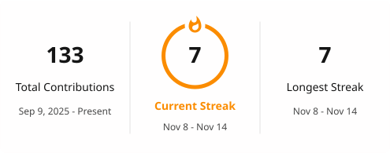

<h1 align="center">Hi, I'm Kwantsimah Orleans Boham 👋</h1>

  <b>Aspiring software engineer · basketball player · media and PR lead</b> 
  Computer Science at Ashesi University

  

  
  
  
  

## About me

- 🎓 **Computer Science at Ashesi University** (class of 2028).
- 💻 **Building with** Python, Java, C++, SQL and the web stack, most recently LLM APIs and machine learning.
- 🏀 **Head of Media & PR** for the Ashesi University Basketball Association, and a player on the women's team.
- 📷 **Outside class:** learning sign language and photography.
- 💼 **Open to** software engineering internships, collaborations and mentorship.

## Featured work

| Project | What it is |
| --- | --- |
| [**LLM decision support**](https://github.com/kwantsimahschool/lab-4-llm-decision-support) | Uses Llama 3.3 70B (via Groq) to summarise loan-application letters, extract their key fields as JSON and draft decision briefs, comparing prompt versions and tracking token use |
| [**Predictive analytics**](https://github.com/kwantsimahschool/lab-2-predictive-analytics) | NYC taxi-tip regression (linear regression and random forest), obesity-level classification and K-Means clustering in Python with scikit-learn |
| [**Unclench**](https://github.com/kwantsimahschool/Synthesis-) | Six-page website for a fictional stress-reliever brand, with a squeezable stress ball and live squeeze counter on the home page; HTML, CSS and JavaScript |
| [**To-do app**](https://github.com/kwantsimahschool/webtech_lab1) | Task list where a jQuery front end calls PHP endpoints over AJAX and stores tasks in MySQL, so the page never reloads |
| **National Blood Bank System Simulation** | Simulation project modelling a national blood bank system (Aug 2026) |

## Tech stack

| Area | Tools |
| --- | --- |
| Languages | Python · Java · C++ · JavaScript · PHP · SQL |
| Web | HTML · CSS · jQuery · MySQL |
| Data and AI | pandas · scikit-learn · matplotlib · Jupyter · LLM APIs (Groq, OpenAI SDK) |
| Tools and design | Git · GitHub · Figma · Canva · Autodesk Revit |

## GitHub stats

  <picture>
    <source media="(prefers-color-scheme: dark)" srcset="./profile/stats-dark.svg">
    
  </picture>
  <picture>
    <source media="(prefers-color-scheme: dark)" srcset="./profile/top-langs-dark.svg">
    
  </picture>

  <picture>
    <source media="(prefers-color-scheme: dark)" srcset="./profile/streak-dark.svg">
    
  </picture>

Cards refresh daily. Top languages reflect public code only, not skill level.

Thanks for stopping by! 🏀

